# Astral Armory

A Roblox combat demo built as a portfolio piece for a VFX + Scripter role (Builder as support).
A floating ruin at sunset, six skills with part-built VFX, a passive tree and support gems in the
style of an ARPG, hollow knights that level you up, and a two-phase boss.

Everything is code: about 11.5k lines of strict Luau, built with Rojo, the logic covered by Lune unit
tests. No meshes, no keyframe animations. Weapons are built from parts at runtime. The player-facing
text is Vietnamese and lives in one file (`src/shared/Config/Strings.luau`).

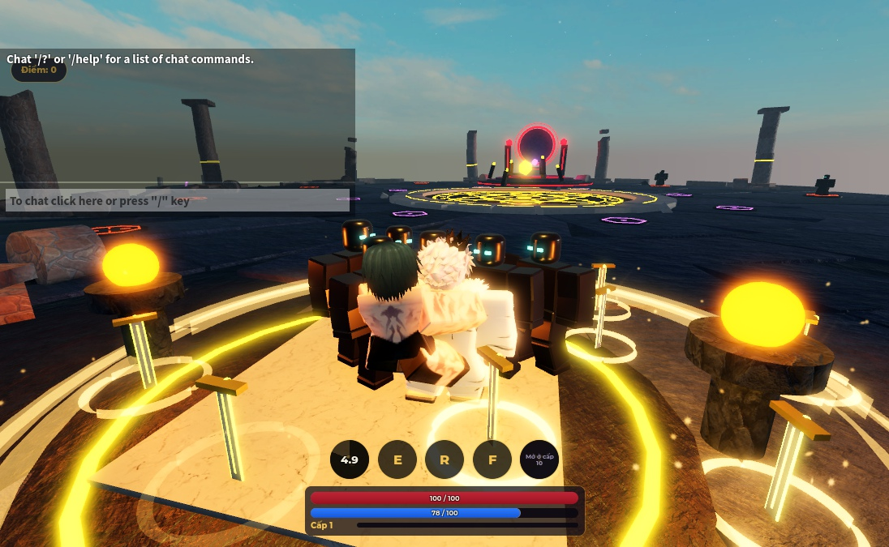

## Controls

| Input | Action |
|---|---|
| M1 (click) | Chém: 3-hit sword combo, the third hit ×1.6 |
| Q | Mưa Kiếm Tinh Tú: a ring of summoned blades rains on the target |
| E | Cột Sáng Bình Minh: a 1.2 s channel, then a 40-stud light beam |
| R | Giáo Huyết: a crimson lance that pierces everything in its lane |
| F | Khiên Lục Giác: a hex shield that absorbs damage for 3 s |
| T | Thăng Hoa: transform for 20 s (+30% damage, radiant skill variants). Unlocks at level 10 |
| P | Passive tree (drag to pan, wheel to zoom, click a node to learn it) |
| G | Support gems (click a gem, then a socket; right-click a socket to remove) |
| B | Summon the boss. Stand at the altar, level 8 or higher |
| `/lvl N` | Studio only: set your level to N |

On touch devices every skill, P, G and the boss summon have on-screen buttons. Aim follows the mouse on
PC and the camera center on touch.

## Systems

- **Server authority.** The client only sends intents (`CastSkill`, `AllocatePassive`, `SocketGem`,
  `SummonBoss`). The server checks unlock, cooldown, cost, life and a 20-casts-per-second limit, clamps
  the target to the skill's range, deals the damage and broadcasts one `FxEvent` that every client
  renders.
- **One resolver.** `Logic/SkillResolver` is the only place that turns skill config, socketed gems,
  stats and the transform into final numbers. The server deals damage from its result and the VFX read
  their variant (element, radiant, blade count, spread) from the same result.
- **Progression.** Levels 1 to 20 with `xpToNext(L) = floor(100 * L^1.5)`. One passive point per level.
- **Passive tree.** 40 nodes in three regions (Uy Lực, Tốc Biến, Thấu Suốt), each with three notables
  and a keystone that changes a rule: skills cost HP instead of Energy, Q gets 6 more blades, or the
  transform lasts until Energy runs out. Free respec.
- **Support gems.** Đa Phát (more projectiles), Băng / Hoả / Lôi (frost slow, flame burn, storm chain,
  at most one per skill), Nổ Lan (bigger area plus an impact burst), Tốc Thi (shorter cooldown).
- **Enemies.** Hollow knights in an inner ring (levels 1–3) and an outer ring (4–8), one AI heartbeat
  for all of them, XP shared by everyone who hit, a 12% gem drop.
- **Boss.** The Eclipse Warden: slams with a 1.2 s telegraph, and below 50% HP enrages and adds shadow
  blades. The altar cools down for 60 s after a kill.
- **Persistence.** DataStore `AstralArmory_v1` saves level, XP, passives and gems on leave and every
  60 s. Without DataStore access (an unpublished place) the session runs in memory.
- **VFX.** One module per skill, pooled parts, every effect cleaned up within its duration + 1 s, at
  most 40 emitters per effect, camera shake only for the caster or within 30 studs. Effects work with
  built-in fallback textures until custom ones are uploaded.
- **Arena.** About 940 parts (budget 2,000). Decor does not collide, large surfaces are few big parts,
  streaming is on.

## Architecture

```
                         ReplicatedStorage.Shared
   Config/  pure data: Skills, Gems, Passives, Progression, Enemies, Strings, AssetIds
   Logic/   pure Luau, no Roblox API, tested in Lune:
            Progression, PassiveTree, GemRules, Stats, SkillResolver, Damage, BladeLayout
   Models/  SwordModel, LanceModel (part-built)      Net.luau (remote names)   VfxPalette

  Client (StarterPlayerScripts.Client)          Server (ServerScriptService.Server)
  ┌──────────────────────────────┐              ┌───────────────────────────────────┐
  │ Input  keys, touch, aim      │── intents ──▶│ PlayerData  profile, DataStore     │
  │ UI     HUD, tree, gems,      │              │ Combat      validation, resolver,  │
  │        damage numbers        │◀─ StateSync ─│             hits, elements, absorb │
  │ Vfx    one module per skill, │◀─ SkillFx ───│ Enemies     spawn rings, AI, XP    │
  │        boss telegraphs       │◀─ BossFx ────│ Boss        altar, phases, rewards │
  └──────────────────────────────┘◀ DamagePopup─└───────────────────────────────────┘
```

`Main.server.luau` starts PlayerData, Combat, Enemies and Boss in that order. `Main.client.luau` starts
Vfx, then UI, then Input.

## Build

Tools: [Rojo](https://rojo.space) 7.7, [Lune](https://lune-org.github.io/docs) 0.11,
[StyLua](https://github.com/JohnnyMorganz/StyLua) 2.6, [Selene](https://github.com/Kampfkarren/selene) 0.32.

```sh
rojo build -o AstralArmory.rbxl     # then open AstralArmory.rbxl in Roblox Studio and press Play
rojo serve                          # or live-sync into Studio through the Rojo plugin
```

The arena is generated: `lune run tools/build_map` writes `assets/Arena.rbxm`. Textures are generated
by `python tools/gen_textures.py` into `assets/textures/`. After you upload them, put the asset ids in
`src/shared/Config/AssetIds.luau`.

## Test

```sh
lune run tests/run          # unit tests for every Logic module
stylua --check src tests tools
selene src
```

## Screenshots

| | |
|---|---|
| 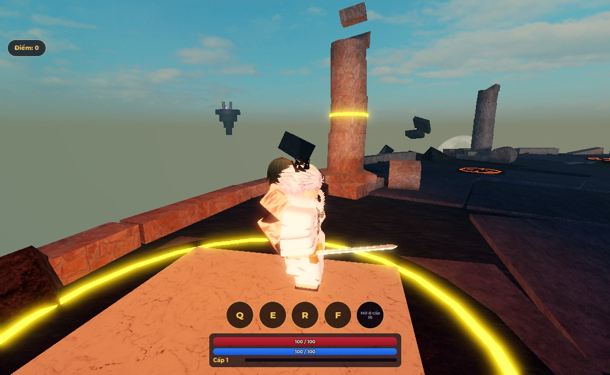 | 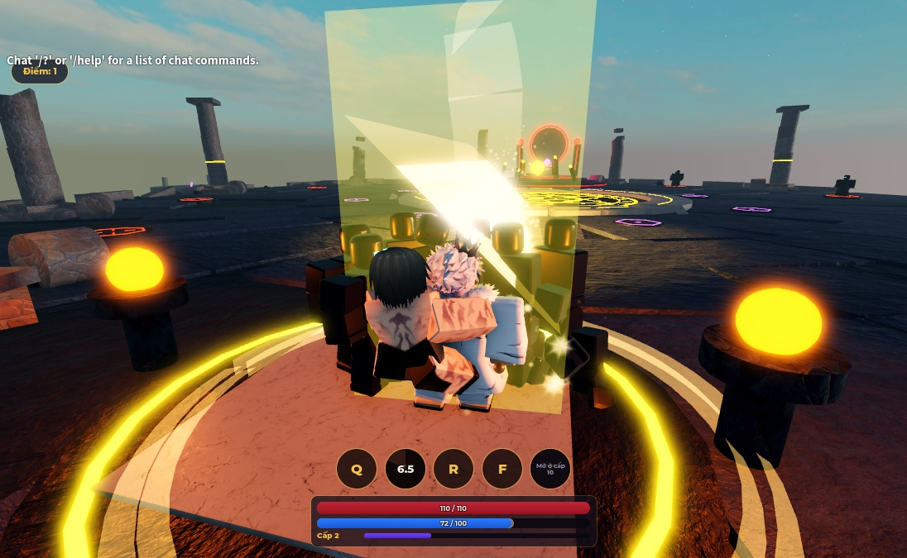 |
| 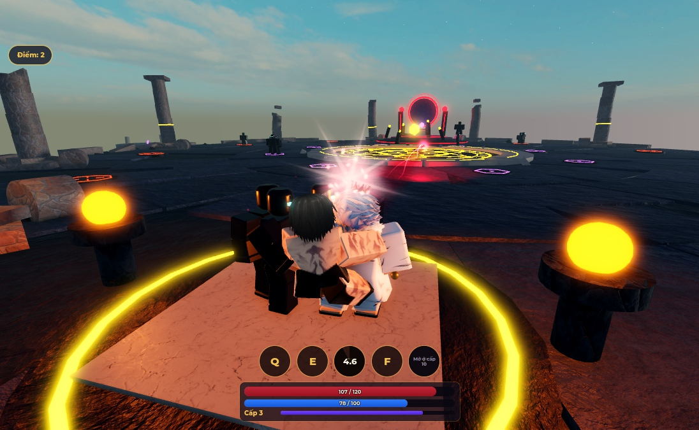 | 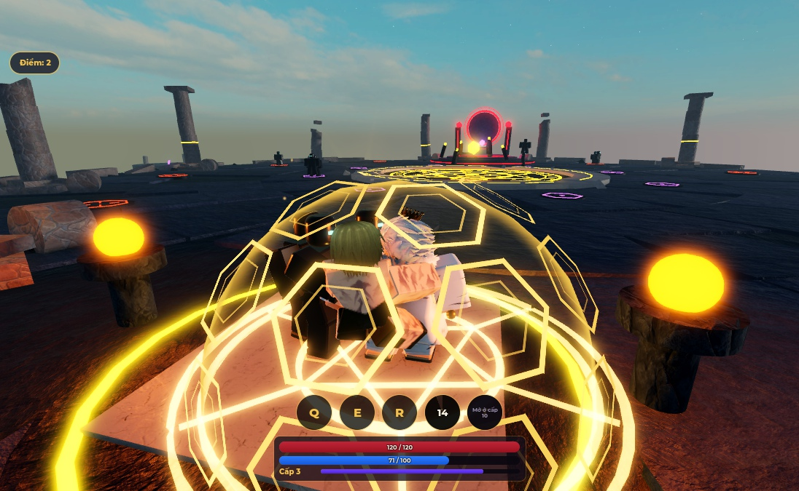 |
| 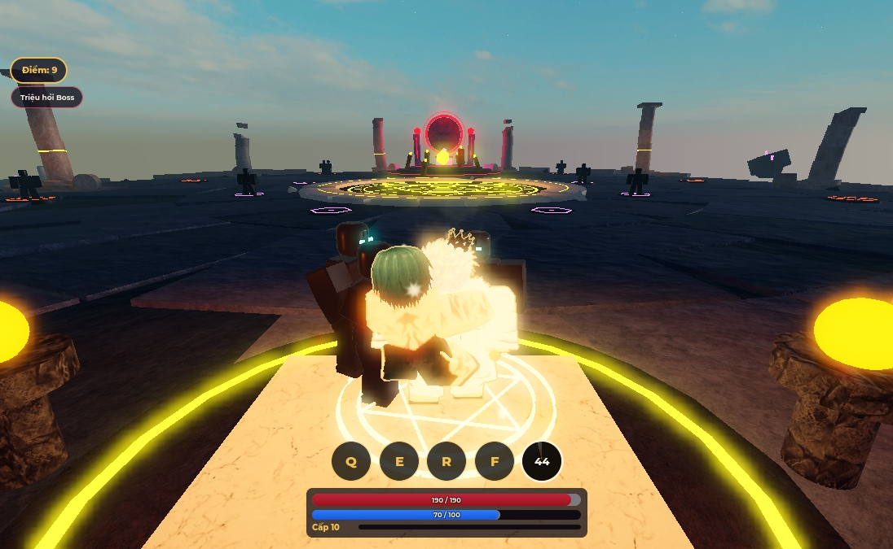 | 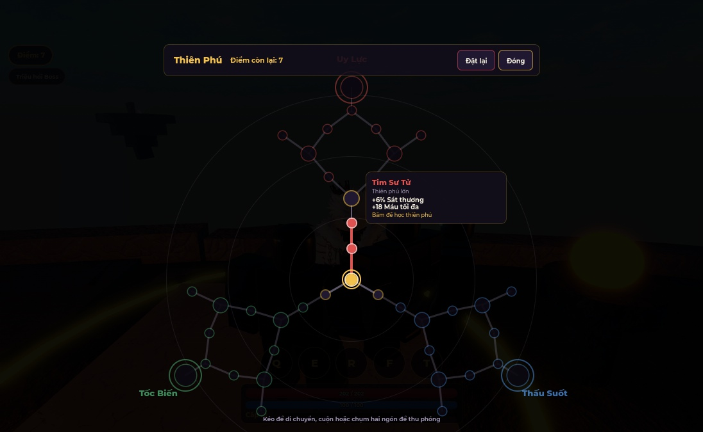 |
| 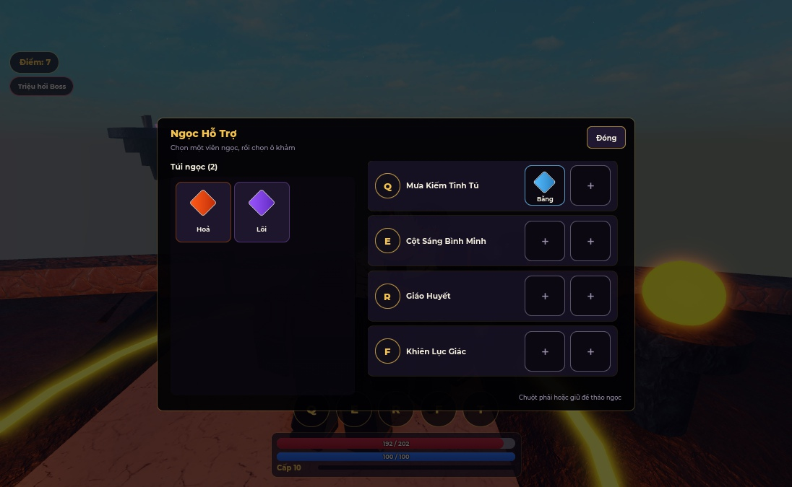 | 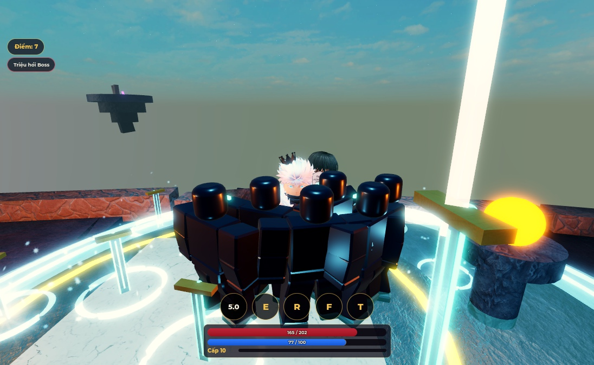 |
| 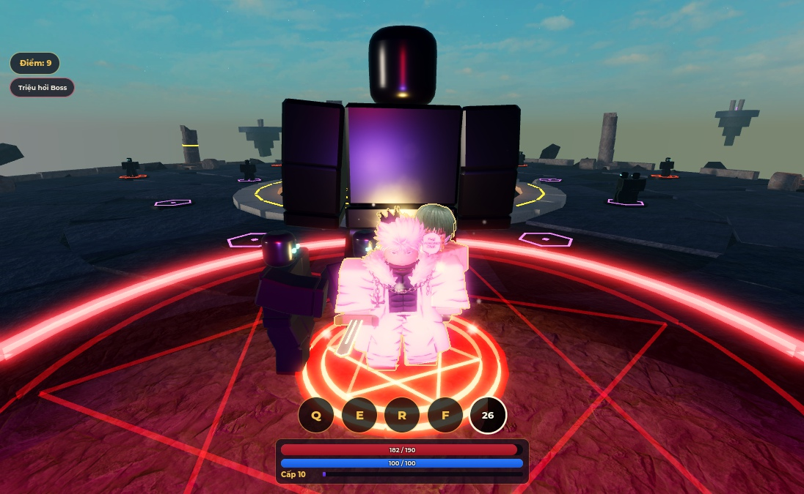 | 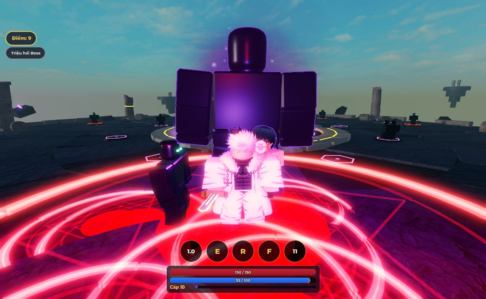 |

## Docs

- Design spec: [`docs/superpowers/specs/2026-11-06-astral-armory-design.md`](docs/superpowers/specs/2026-11-06-astral-armory-design.md)
- Build plan: [`docs/superpowers/plans/2026-11-06-astral-armory.md`](docs/superpowers/plans/2026-11-06-astral-armory.md)
- Video reel shot list: [`docs/reel-script.md`](docs/reel-script.md)
